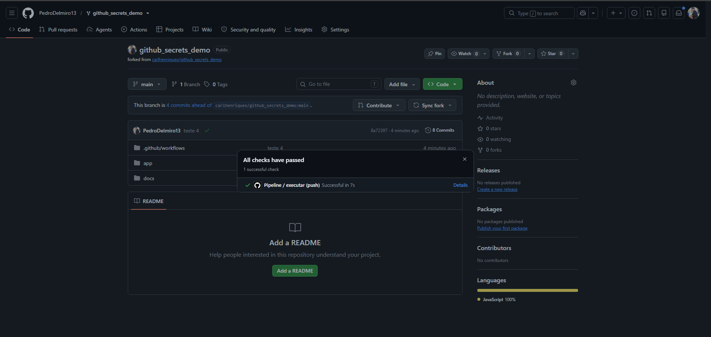
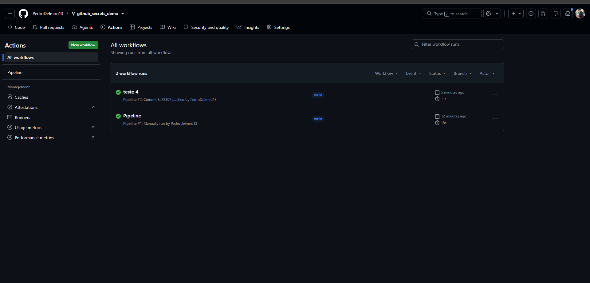
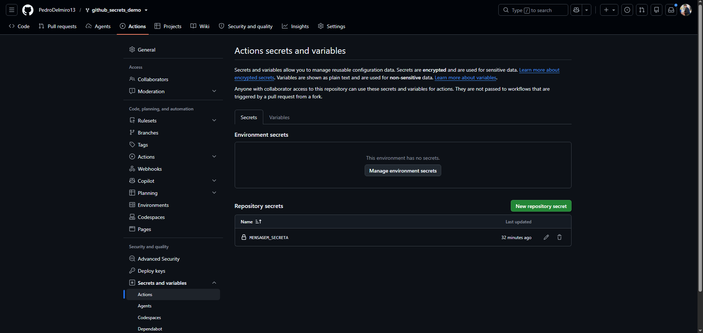

# ATIVIDADE PRÁTICA — UTILIZAÇÃO DE GITHUB SECRETS

## Objetivo

Compreender como utilizar o GitHub Secrets para armazenar informações sensíveis utilizadas por uma aplicação ou pipeline de CI/CD.

Nesta atividade, você receberá uma aplicação simples em Node.js e deverá modificar a pipeline para que uma informação sensível não fique armazenada diretamente no código do projeto.

O objetivo principal é compreender o fluxo:

**Secret → GitHub → GitHub Actions → Variável de ambiente → Aplicação**

## 1. Contexto

Neste projeto, existe uma variável chamada `MENSAGEM_SECRETA`. Inicialmente, essa informação está definida diretamente no arquivo da pipeline. Isso representa uma prática inadequada, pois o arquivo do workflow fica armazenado no repositório.

O objetivo será retirar essa informação do código e armazená-la como um **GitHub Secret**.

## 2. Projeto inicial

O projeto possui a seguinte estrutura:

```text
github-secrets-demo/
├── app/
│   ├── package.json
│   └── server.js
├── .github/
│   └── workflows/
│       └── main.yml
└── README.md
```

A aplicação utiliza Node.js e Express.

O arquivo `server.js` obtém a informação por meio da variável de ambiente:

```javascript
process.env.MENSAGEM_SECRETA
```

## 3. Situação inicial

Analise o arquivo `main.yml`.

Você encontrará uma configuração semelhante a:

```yaml
env:
  MENSAGEM_SECRETA: "Minha mensagem secreta"
```

Identifique o problema existente nessa configuração.

Responda:

1. Onde o segredo está armazenado?
2. Quem poderia visualizar essa informação?
3. Por que essa prática não é recomendada?
4. O que poderia acontecer se essa informação fosse uma senha ou um token real?

## 4. Criando o GitHub Secret

O GitHub permite armazenar informações sensíveis nas configurações do repositório. Esses valores podem posteriormente ser utilizados pelas GitHub Actions sem precisar colocá-los diretamente nos arquivos do projeto.

Para criar o Secret:

1. Acesse o repositório do projeto no GitHub.

2. No menu superior do repositório, clique em **Settings**.

3. No menu lateral esquerdo, localize a seção **Security**.

4. Acesse:

```text
Secrets and variables
        ↓
Actions
```

5. Na página de **Actions secrets and variables**, permaneça na aba **Secrets**.

6. Clique em:

```text
New repository secret
```

7. No campo **Name**, informe:

```text
MENSAGEM_SECRETA
```

8. No campo **Secret**, informe uma mensagem definida por você.

Por exemplo:

```text
Esta mensagem está protegida pelo GitHub Secrets
```

9. Clique em **Add secret**. Depois da criação, o Secret deverá aparecer na lista de **Repository secrets**.

## 5. Alterando a pipeline

Modifique o arquivo:

```text
.github/workflows/main.yml
```

Remova o valor que estava definido diretamente no arquivo.

A pipeline deverá utilizar o Secret criado no GitHub.

Como o Secret desta atividade se chama `MENSAGEM_SECRETA`, use:

```yaml
${{ secrets.MENSAGEM_SECRETA }}
```

A aplicação deverá continuar recebendo a informação através da variável de ambiente:

```text
MENSAGEM_SECRETA
```

## 6. Validação

Faça um commit e envie as alterações para o GitHub.

Verifique se a pipeline é executada corretamente.

Depois, confirme que:

* a aplicação continua recebendo a mensagem;
* o arquivo `main.yml` não possui mais o valor real do segredo;
* o valor do Secret não foi colocado diretamente no código;
* o valor sensível não foi exibido nos logs da pipeline.

## 7. Questões

Responda:

1. Qual é a diferença entre armazenar o valor diretamente no `pipeline.yml` e armazená-lo no GitHub Secrets?

2. Onde o valor do Secret fica configurado?

3. O valor do Secret deve ser colocado no código da aplicação?

4. Qual é a função de:

```javascript
process.env.MENSAGEM_SECRETA
```

5. Por que utilizar Secrets é importante em uma pipeline de CI/CD?

6. Se fosse necessário utilizar uma senha real de banco de dados, por que seria inadequado colocar essa senha diretamente no arquivo `.yml`?

## 8. Entrega

Além disso, o aluno deverá entregar uma breve documentação contendo:

* explicação do problema encontrado;
* nome do Secret utilizado;
* explicação de como o Secret chegou até a aplicação;
* evidência de execução da pipeline;
* respostas das questões propostas.

## Resultado esperado

Ao final da atividade, você deverá compreender que informações sensíveis podem ser retiradas do código e armazenadas de forma separada no GitHub. Dessa forma, o código não precisa conhecer diretamente o valor do segredo.

A atividade representa uma introdução ao gerenciamento de Secrets em pipelines de CI/CD e servirá como base para utilização de credenciais, tokens, senhas e chaves em projetos posteriores.

## Respostas da atividade

### Problema encontrado

Um valor escrito diretamente no arquivo do workflow fica no histórico do repositório e pode ser visto por quem tem acesso a ele. Se fosse uma senha ou um token real, outras pessoas poderiam usar essa credencial para acessar sistemas ou dados.

O Secret deve ser criado nas configurações do repositório em **Settings → Secrets and variables → Actions**, com o nome `MENSAGEM_SECRETA`. O workflow deve referenciá-lo como `${{ secrets.MENSAGEM_SECRETA }}` e passá-lo à aplicação pela variável de ambiente `MENSAGEM_SECRETA`.

### Respostas às questões

1. Um valor escrito diretamente no `main.yml` fica no histórico do repositório, um GitHub Secret é configurado separadamente e injetado no workflow durante a execução.
2. O valor é configurado nas configurações do repositório, em **Secrets and variables → Actions**. O nome usado nesta atividade é `MENSAGEM_SECRETA`.
3. Não. O valor não deve ser colocado no código, a aplicação lê a variável de ambiente `MENSAGEM_SECRETA`.
4. `process.env.MENSAGEM_SECRETA` lê, no Node.js, o valor da variável de ambiente disponibilizada ao processo.
5. Secrets permitem usar credenciais no CI/CD sem armazená-las diretamente no código versionado e sem exibi-las intencionalmente nos logs.
6. Uma senha no arquivo `.yml` poderia permanecer no histórico mesmo após sua remoção e ser acessada por pessoas com acesso ao repositório. Uma senha exposta deve ser revogada e substituída.

### Fluxo e validação

O GitHub armazena o Secret `MENSAGEM_SECRETA`; o GitHub Actions o associa à variável de ambiente de mesmo nome no passo que executa `app/server.js`; a aplicação obtém o valor por `process.env.MENSAGEM_SECRETA`. O workflow é iniciado por um push para qualquer branch ou manualmente pela aba **Actions**, usando **Run workflow**.



